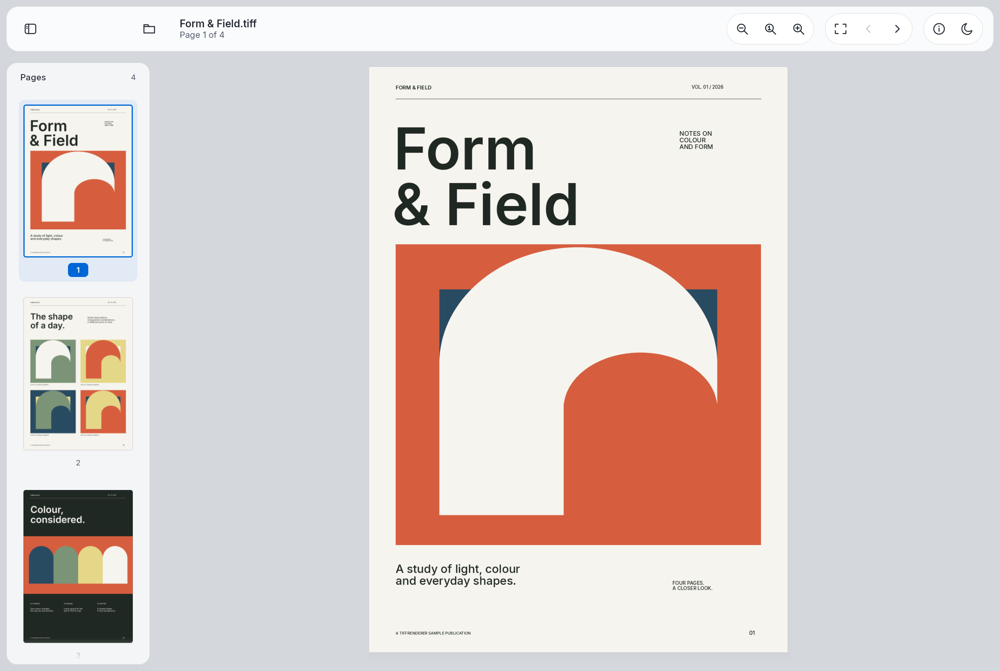

# TiffRenderer

[](https://central.sonatype.com/artifact/io.github.lucf15/tiffrenderer)
[](https://github.com/lucf15/TiffRenderer/actions/workflows/ci.yml)
[](LICENSE)

[](#platforms)
[](#android)
[](#ios--kotlin-multiplatform)
[](#jvm--desktop)
[](#web--kotlinwasm)

TIFF decoding and rendering for Kotlin Multiplatform: Android, iOS, JVM and Kotlin/Wasm.
Supports single-page and multipage files through libtiff, with configurable memory limits.

> These examples use the **4.0 API**, which replaces the 3.x renderer and page APIs.
> For the previous release, see the [3.0 documentation](https://github.com/lucf15/TiffRenderer/tree/v3.0.0#readme).

[Web demo](https://lucf15.github.io/TiffRenderer/) · [Get started](#get-started) · [Platforms](#platforms) · [Rendering](#rendering) · [Output size](#output-size) ·
[Migration](#migration-to-40) ·
[Resources and cancellation](#resources-and-cancellation) · [Limits](#limits) ·
[Codec support](#codec-support) · [Native libraries](#native-libraries) ·
[Sample app](#sample-app) · [Building and testing](#building-and-testing)

## Get started

Add the dependency from Maven Central:

```kotlin
kotlin {
    sourceSets.commonMain.dependencies {
        implementation("io.github.lucf15:tiffrenderer:4.0.0")
    }
}
```

Plain JVM and Android projects can add the same dependency in their `dependencies` block.
The published artifacts include the native libraries; consumers do not need an NDK or CMake.

The Kotlin document API is **suspending**. Call it from a `suspend` function or an existing
coroutine scope. For example, render the first page inside a 1200 × 1600 pixel bounding box:

```kotlin
import io.github.lucf15.tiffrenderer.RenderSize
import io.github.lucf15.tiffrenderer.TiffBitmap
import io.github.lucf15.tiffrenderer.TiffRenderer
import io.github.lucf15.tiffrenderer.TiffSource

suspend fun renderFirstPage(source: TiffSource): TiffBitmap =
    TiffRenderer.withDocument(source) { document ->
        document.renderPage(
            pageIndex = 0,
            size = RenderSize.fit(maxWidth = 1200, maxHeight = 1600),
        ).image
    }
```

Page indices start at **0**. Sizes are in **pixels**. The document closes when the block
finishes, including after failure or cancellation. The returned image remains valid.

For a single render, `TiffRenderer.render(source, pageIndex, size)` opens and closes the
document automatically and returns a `TiffRenderResult` containing the image and warnings.

### Suspending and synchronous calls

| API | Execution |
|---|---|
| Kotlin `open`, `withDocument`, `use`, `render` | `suspend` |
| Document `pageCount`, `pageInfo`, `renderPage`, `renderInto`, `trimCache`, `close` | `suspend` |
| `TiffSource.from…`, `RenderSize.fit`, option constructors, returned metadata properties | Synchronous |
| Pixel exports and image conversions | Synchronous; may allocate and copy pixels |
| JVM `BlockingTiffRenderer` | Blocks the calling thread |
| JVM `TiffFutures.render` / `TiffRenderer.renderAsync` | Returns a `CompletableFuture` |
| Swift adapter `TiffRenderer.render` | `async throws` |

The suspend API dispatches native work internally. Calling it from a UI coroutine does not
require wrapping it in `withContext(Dispatchers.IO)`. This does not apply to synchronous pixel
exports or conversions; keep large copies off the UI thread.

The Kotlin examples below run inside a suspend function or coroutine.

## Platforms

| Target | Minimum runtime | Native architectures |
|---|---|---|
| Android | API 24 | arm64-v8a, armeabi-v7a, x86_64, x86 |
| iOS | iOS 15 | ARM64 devices and simulators |
| JVM / desktop | JDK 17 | macOS, Linux and Windows: x86-64 and ARM64 |
| Web | Wasm GC, Wasm exception handling and Web Workers | Kotlin/Wasm |

Use the platform's file type directly, or create a reusable `TiffSource` for shared code.
Each open creates an independent document and acquires its own resources.

### Android

Render a URI returned by the system file picker to an Android `Bitmap`:

```kotlin
import android.content.Context
import android.graphics.Bitmap
import android.net.Uri
import io.github.lucf15.tiffrenderer.TiffRenderer
import io.github.lucf15.tiffrenderer.renderBitmap

suspend fun readTiff(context: Context, uri: Uri): Bitmap =
    TiffRenderer.renderBitmap(
        context = context,
        uri = uri,
        pageIndex = 0,
        maxWidth = 1200,
        maxHeight = 1600,
    )
```

For repeated page renders, keep a document open with `TiffRenderer.open(context, uri)`
and close it in `finally`, or use `withDocument(TiffSource.fromUri(context, uri)) { ... }`.

`open(file)` and `open(parcelFileDescriptor)` are also available. Descriptor inputs are
duplicated: the caller keeps ownership of the original, and rendering uses an independent
read position. Keep the original descriptor open until `open()` returns.

### JVM / desktop

```kotlin
import java.awt.image.BufferedImage
import java.nio.file.Path
import io.github.lucf15.tiffrenderer.RenderSize
import io.github.lucf15.tiffrenderer.TiffRenderer
import io.github.lucf15.tiffrenderer.TiffSource
import io.github.lucf15.tiffrenderer.toBufferedImage
import kotlinx.coroutines.Dispatchers
import kotlinx.coroutines.withContext

suspend fun readTiff(path: Path): BufferedImage {
    val result = TiffRenderer.render(
        source = TiffSource.fromPath(path),
        pageIndex = 0,
        size = RenderSize.fit(1200, 1600),
    )
    return withContext(Dispatchers.Default) { result.image.toBufferedImage() }
}
```

`Path`, `File`, and path strings are supported. Native libraries cover macOS, Linux and
Windows on x86-64 and ARM64.

From a Java method running off the UI thread, use `BlockingTiffRenderer` with
try-with-resources:

```java
import java.awt.image.BufferedImage;
import java.nio.file.Path;
import io.github.lucf15.tiffrenderer.BlockingTiffRenderer;

public final class TiffExample {
    public static BufferedImage read(Path path) {
        try (var document = BlockingTiffRenderer.open(path)) {
            return document.renderImage(0, 1200, 1600);
        }
    }
}
```

Its methods block the calling thread; use it outside UI threads. `TiffFutures.render(...)`
returns a `CompletableFuture`; cancelling the future cancels its coroutine request.

### iOS / Kotlin Multiplatform

```kotlin
import platform.Foundation.NSURL
import platform.UIKit.UIImage
import io.github.lucf15.tiffrenderer.RenderSize
import io.github.lucf15.tiffrenderer.TiffRenderer
import io.github.lucf15.tiffrenderer.TiffSource
import io.github.lucf15.tiffrenderer.toUIImage
import kotlinx.coroutines.Dispatchers
import kotlinx.coroutines.withContext

suspend fun readTiff(url: NSURL): UIImage {
    val result = TiffRenderer.render(
        source = TiffSource.fromUrl(url),
        pageIndex = 0,
        size = RenderSize.fit(1200, 1600),
    )
    return withContext(Dispatchers.Default) { result.image.toUIImage() }
}
```

File URLs retain security-scoped access for the lifetime of the opened document when needed.
The library supports iOS 15+ on ARM64 devices and simulators.

For Swift, build the local package with `scripts/build-swift-package.sh`, then add `lib/swift`
as a local Swift package in Xcode:

```swift
import Foundation
import UIKit
import TiffRenderer

@MainActor
func readTiff(url: URL) async throws -> UIImage {
    try await TiffRenderer.render(
        url: url,
        pageIndex: 0,
        maxWidth: 1200,
        maxHeight: 1600
    )
}
```

The Swift adapter maps task cancellation to the Kotlin request and closes its document
before completing. The package build requires macOS and Xcode.

### Web / Kotlin/Wasm

Prefer the browser `File` or `Blob` directly:

```kotlin
import org.w3c.files.File
import io.github.lucf15.tiffrenderer.RenderSize
import io.github.lucf15.tiffrenderer.TiffBitmap
import io.github.lucf15.tiffrenderer.TiffRenderer
import io.github.lucf15.tiffrenderer.TiffSource

suspend fun readTiff(file: File): TiffBitmap =
    TiffRenderer.render(
        source = TiffSource.fromBlob(file),
        pageIndex = 0,
        size = RenderSize.fit(1200, 1600),
    ).image
```

Each document runs in its own worker. Files are read there, so large inputs do not pass through
base64 strings or Kotlin byte arrays on the UI thread. Closing the document terminates its
worker and releases its Wasm heap.

Rendered pixels remain in a JavaScript `ArrayBuffer`. The sample's Compose bridge uses
Skiko's `installPixelsFromArrayBuffer` to display them without an intermediate Kotlin copy.
The browser must support Kotlin/Wasm, workers, and the typed-array base64 APIs used by explicit
Kotlin byte-array import/export.

### In-memory input

Available on every platform:

```kotlin
import io.github.lucf15.tiffrenderer.TiffSource

fun sourceFromMemory(bytes: ByteArray): TiffSource = TiffSource.fromByteArray(bytes)
```

This takes an independent snapshot. Prefer file/URI/URL/Blob input for large documents to
avoid the extra copy. The source is reusable and has no `close()` or `release()` obligation.

## Migration to 4.0

Version 4.0 changes the document and page API. Update the Maven Central dependency to
`io.github.lucf15:tiffrenderer:4.0.0`. Versions before 2.0 used the JitPack coordinate
`com.github.lucf15:TiffRenderer`; replace that dependency rather than adding both.

In 3.x, a typical render opened a page and supplied a destination bitmap:

```kotlin
// 3.x
TiffRenderer.open(source).use { renderer ->
    renderer.openPage(0).use { page ->
        val bitmap = createTiffBitmap(page.width, page.height)
        page.render(bitmap, renderMode = TiffRenderMode.FOR_DISPLAY)
    }
}
```

In 4.0, render directly from the document. This example returns the image and closes the
document even if rendering fails:

```kotlin
import io.github.lucf15.tiffrenderer.RenderSize
import io.github.lucf15.tiffrenderer.TiffBitmap
import io.github.lucf15.tiffrenderer.TiffRenderer
import io.github.lucf15.tiffrenderer.TiffSource

suspend fun renderFirstPage(source: TiffSource): TiffBitmap =
    TiffRenderer.withDocument(source) { document ->
        document.renderPage(0, RenderSize.Original).image
    }
```

| 3.x | 4.0 |
|---|---|
| `openPage(index)` and page `width` / `height` | `pageInfo(index)` |
| `page.render(bitmap, clip, transform, mode)` | `document.renderInto(index, bitmap, clip, transform, sampling)` |
| `TiffRenderMode.FOR_DISPLAY` / `FOR_PRINT` | `TiffSampling.SMOOTH` / `NEAREST` |
| `page.retainRaster()` / `releaseRaster()` | Set `TiffOptions(cacheBytes = ...)` when opening; use `trimCache()` to release the cache |
| Single-use `TiffSource`, with `release()` for unused sources | Reusable `TiffSource`; each open acquires its own resources |

Kotlin document operations remain suspending. `renderPage` returns a `TiffRenderResult`, so
read its `image` and inspect `warnings` when partial decoding is enabled. Strict decoding and
memory limits are now enabled by default; see [damaged files](#damaged-files) and [limits](#limits).
For 1.x and 2.x platform-specific APIs, consult the documentation for your installed version
before moving to the 4.0 document API.

## Rendering

| Document method | Returns | Purpose |
|---|---|---|
| `suspend pageCount()` | `Int` | Number of pages; resolved lazily by walking TIFF directories |
| `suspend pageInfo(index)` | `TiffPageInfo` | Original `width`, `height`, `index` and `rasterBytes` estimate |
| `suspend renderPage(index, size, sampling)` | `TiffRenderResult` | A new output image and any decode warnings |
| `suspend renderInto(index, destination, clip, transform, sampling)` | `Set<TiffWarning>` | Render into an existing bitmap |
| `suspend trimCache()` | `Unit` | Release the retained decoded raster |
| `suspend close()` | `Unit` | Release the document and its acquired resources |

`sampling` defaults to `TiffSampling.SMOOTH`; `clip` and `transform` default to `null`.
`TiffRenderResult.image` remains valid after the document closes.

### Output size

`RenderSize` has two variants. The lowercase `fit(...)` factory constructs a `RenderSize.Fit`.
There are no separate width-only, height-only, crop or stretch factories.

| Size | Behaviour |
|---|---|
| `RenderSize.fit(maxWidth, maxHeight)` | Fit inside both bounds, preserve aspect ratio, never upscale |
| `RenderSize.fit(maxWidth, maxHeight, allowUpscale = true)` | Same fit, with upscaling allowed |
| `RenderSize.Fit(maxWidth, maxHeight, allowUpscale = false)` | Direct constructor for the same options |
| `RenderSize.Original` | Render at the page's native dimensions |

Both fit bounds are required, must be positive, and are measured in pixels. The output can
be smaller than either bound; `fit` does not add padding or force an exact bitmap size.
For a 4000 × 2000 page, `fit(1200, 1200)` produces a 1200 × 600 image.
`fit(6000, 6000)` keeps it at 4000 × 2000; allowing upscaling produces 6000 × 3000.

```kotlin
import io.github.lucf15.tiffrenderer.RenderSize

val thumbnail = RenderSize.fit(240, 320)
val fitWidth = RenderSize.fit(maxWidth = 1200, maxHeight = Int.MAX_VALUE)
val fitHeight = RenderSize.fit(maxWidth = Int.MAX_VALUE, maxHeight = 1600)
val original = RenderSize.Original
```

Every size, including `Original`, is subject to the document's output and decoding limits.
A smaller fit bounds the output allocation; it does not avoid decoding the full source page.
For a fixed-size canvas, clipping or positioning, use `renderInto` with a destination bitmap.

### Sampling and transforms

`TiffSampling.SMOOTH` uses bilinear sampling with mip minification. `NEAREST` preserves discrete
source pixels. `TiffTransform.scale`, `translate`, `rotate`, and `identity` build affine transforms.

Advanced in-place rendering accepts `TiffRect` and `TiffTransform`; Android also accepts native
`Bitmap`, `Rect` and `Matrix` values. Pixels outside the clip or transformed page are preserved.
An in-place operation can modify the destination before reporting a decode error.

### Damaged files

Strict decoding is the default. A partial decode throws `TiffIOException` instead of silently
returning an incomplete page. To accept recoverable damage explicitly:

```kotlin
import io.github.lucf15.tiffrenderer.RenderSize
import io.github.lucf15.tiffrenderer.TiffDecodePolicy
import io.github.lucf15.tiffrenderer.TiffOptions
import io.github.lucf15.tiffrenderer.TiffRenderResult
import io.github.lucf15.tiffrenderer.TiffRenderer
import io.github.lucf15.tiffrenderer.TiffSource

suspend fun readDamagedPage(source: TiffSource): TiffRenderResult =
    TiffRenderer.render(
        source = source,
        pageIndex = 0,
        size = RenderSize.fit(1200, 1600),
        options = TiffOptions(decodePolicy = TiffDecodePolicy.ALLOW_PARTIAL),
    )
```

Check `result.warnings` for `TiffWarning.PARTIAL_DECODE` before displaying the result
as a complete page.

`TiffIOException.reason` distinguishes resource limits, partial decoding, unavailable input,
worker failures and decode errors. Invalid arguments and use after close remain programming errors.

## Resources and cancellation

| Resource | Ownership |
|---|---|
| Input description | Reusable; owns no open file descriptor |
| Open document | Owns its acquired input, native decoder, worker and raster cache |
| Rendered image | Independent of the document; follows platform GC/ARC lifetime |
| Borrowed pixel view | Valid according to its platform contract; never transfer/detach its backing storage |

Operations on one document are serialized internally. Callers can request different pages from
concurrent coroutines without a separate mutex. `close()` waits for exclusive access, releases
resources even from a cancelled coroutine, and is safe to call repeatedly.

`open`, metadata reads, rendering, cache release and close are suspending operations. Reading
already returned page properties and constructing render options are synchronous. Pixel exports
such as `copyPixels()` and conversions such as `toBufferedImage()` allocate/copy memory.

Cancellation stops waiting and prevents stale results from being published. A native libtiff call
already in progress may finish before cleanup can complete. Suspending does not imply immediate
interruption of native decoding.

## Limits

The decoder always reads the **full source page** before resampling. A small thumbnail reduces
output memory, not the source raster's decoding cost.

Configure these per-document defaults with `TiffOptions(limits = ...)`:

| Limit | Default |
|---|---:|
| Input file | 128 MiB |
| Decoded source page | 128 MiB |
| Output image | 64 MiB |
| Native working budget | 256 MiB |
| Retained raster cache | Off |

Use `TiffOptions(cacheBytes = 16L * 1024 * 1024)` to keep a small decoded page for repeated
renders. The working budget accounts for native raster, mip, cache and destination costs,
with a 32 MiB reserve for libtiff. It is not a process-wide RSS cap: platform images,
allocator capacity and concurrent documents have additional costs. libtiff allocations
have a separate 32 MiB cumulative cap.

The native core also enforces hard upper bounds. Decode/working/output limits are checked before
large rendering allocations. In-memory inputs require extra staging space. A cache only retains
a page that fits `cacheBytes`, is released on document close, and can be trimmed explicitly.

Color output is 8-bit RGBA without ICC color management. High-bit-depth and floating-point TIFFs
lose precision when converted for display.

## Codec support

| Compression | Supported | Decoder |
|---|---|---|
| Uncompressed | Yes | libtiff |
| PackBits | Yes | libtiff |
| LZW | Yes | libtiff |
| CCITT Group 3/4 | Yes | libtiff |
| Deflate / ZIP | Yes | zlib |
| JPEG-in-TIFF | Yes | IJG libjpeg |
| WebP-in-TIFF | Yes | libwebp |
| Zstd, LERC, LZMA, JBIG, legacy JPEG | No | Not enabled in this build |

## Native libraries

Pinned Git submodules under `lib/native/src/main/cpp/third_party/`, shared by every platform:

| Library | Version |
|---|---|
| [libtiff](https://gitlab.com/libtiff/libtiff) | 4.7.2 |
| [IJG libjpeg](https://github.com/libjpeg-turbo/ijg) | 10 |
| [libwebp](https://github.com/webmproject/libwebp) | 1.6.0 |

The dependency-update workflows update these submodules and this table together.
zlib comes from the platform/toolchain; Wasm uses Emscripten's zlib port.
Licenses and copyright notices are in [THIRD_PARTY_LICENSES.md](THIRD_PARTY_LICENSES.md).

## Sample app

[Open the web demo](https://lucf15.github.io/TiffRenderer/) to test bundled documents or import a TIFF.
Files are decoded locally in the browser and are not uploaded.

The Compose Unstyled sample runs on Android, iOS, desktop and Wasm. It includes a resizable
thumbnail sidebar, fit-width and fit-page modes, keyboard shortcuts and native file pickers.
To return to the sample list, close the document from the information panel.

<picture>
  <source media="(prefers-color-scheme: dark)" srcset="docs/images/sample-dark.png">
  
</picture>

```shell
./gradlew :sample:desktopApp:run
./gradlew :sample:webApp:wasmJsBrowserDevelopmentRun
./gradlew :sample:androidApp:assembleDebug
```

The iOS sample targets iOS 18.2+. Open `sample/iosApp/iosApp.xcodeproj` to run it. On the web, the dev server normally listens
on [localhost:8080](http://localhost:8080).

Generate optional local test documents with:

```shell
python3 sample/tiff-examples/generate_samples.py
```

Requires Pillow and the fonts selected by the script. It produces small text documents,
multipage faxes, noisy color scans and a larger uncompressed TIFF. Generated test binaries are ignored
by Git. To regenerate the bundled publication, run
`python3 sample/tiff-examples/generate_catalog.py` with Pillow installed; it uses the bundled Inter fonts.

## Building and testing

Initialize native dependencies after cloning:

```shell
git submodule update --init --recursive
```

Use the Gradle wrapper and the toolchain versions in `gradle/libs.versions.toml`. Native builds
require the Android SDK/NDK and CMake; iOS additionally requires Xcode, and Wasm requires Emscripten.

```shell
./gradlew :lib:core:jvmTest
./gradlew :lib:core:wasmJsTest
./gradlew :lib:core:iosSimulatorArm64Test
./gradlew :lib:core:connectedAndroidDeviceTest
./gradlew :sample:webApp:wasmJsTest
node --test lib/native/src/test/js/tiffcore-glue.test.mjs
```

Browser tests require Chrome/Chromium. Android tests require a device/emulator; iOS tests require
a compatible simulator. CI runs decode fixtures, worker lifecycle tests, native sanitizer
checks and scheduled fuzzing. Fuzz reports in third-party dependencies are retained as artifacts;
the scheduled job fails when a report implicates project code or cannot be classified.

The C++ core uses libtiff, IJG libjpeg and libwebp. See [third-party licenses](THIRD_PARTY_LICENSES.md).

## License

[Apache 2.0](LICENSE).
